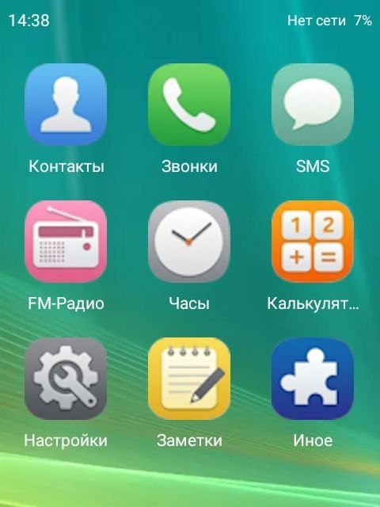
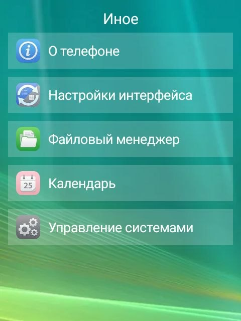

# Qin Army Edition Launcher

Кастомный лаунчер для кнопочных телефонов на базе Android (тестировался на Qin F22). 
Превращает смартфон в стильный кнопочный телефон с поддержкой физических клавиш (D-pad), кастомными приложениями и блокировкой сенсора.

## 📸 Скриншоты

| Главное меню (Список) | Главное меню (Сетка) |
| :---: | :---: |
|  |  |

| Экран блокировки | Встроенные приложения |
| :---: | :---: |
|  |  |

## ✨ Особенности
* **Два интерфейса на выбор**: Список (как в классических телефонах) и Сетка 3x3 (с крупными иконками).
* **Полная адаптация под кнопки**: Навигация стрелками, выбор центральной кнопкой.
* **Блокировка тачскрина**: Случайные нажатия на экран не сбивают фокус.
* **Экран блокировки**: Появляется по таймеру бездействия или при возврате в лаунчер. Разблокировка на `*`.
* **Встроенные приложения**: 
  * Радио (с эквалайзером, шкалой и проверкой наушников).
  * Заметки (с сохранением в память).
  * Вызов системного калькулятора.
* **Управление системами**: Встроенный список всех приложений с сортировкой по алфавиту.

## 📲 Установка
1. Скачайте APK из раздела **[Releases](../../releases)**.
2. Установите на устройство.
3. При первом запуске выберите стиль интерфейса (Список или Сетка).
4. В настройках Android выберите **Qin Army Edition** как приложение по умолчанию для «Главного экрана».

## 🛠️ Сборка из исходников
1. Откройте проект в Android Studio.
2. Сделайте **Build -> Generate App Bundles or APKs -> Generate APKs**.
3. APK будет лежать в `app/build/outputs/apk/debug/app-debug.apk`.

## 📋 Требования
* Android 8.0+ (API 26+), но идеально работает на Android 11.
* Разрешение на показ поверх других окон (для экрана блокировки).